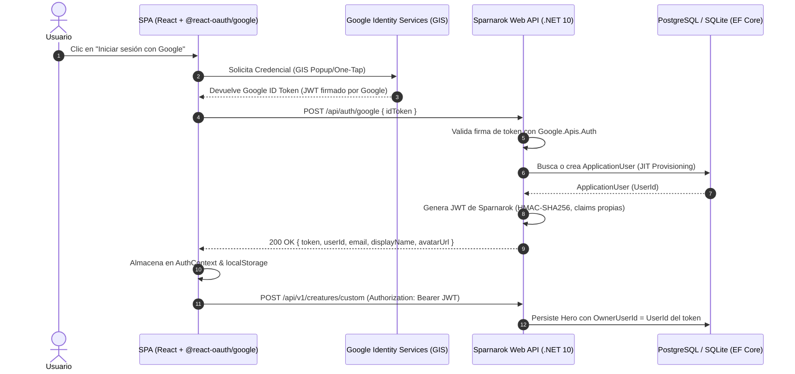

# ADR-0013: Autenticación Social con Google OAuth2 y Emisión de JWT Propios para Persistencia e Identidad en SPA

- **Fecha:** 2026-10-22
- **Estado:** Aceptado
- **Decisores:** Equipo de Arquitectura de Sparnarok

## Contexto y Problema
Hasta la Fase 2.4, Sparnarok: The Architect's Codex funcionaba con un esquema de datos sin segregación por usuario. Todas las criaturas creadas o sincronizadas eran públicas y accesibles por cualquier visitante. Al iniciar la **Fase 3: Cloud Persistence & Identity**, se requería:
1. Identificar de forma unívoca a los usuarios mediante autenticación federada (Google OAuth2), evitando la fricción y los riesgos de seguridad de gestionar contraseñas locales (hashing, salting, resets).
2. Asociar las entidades personalizadas (especialmente Héroes Custom y composiciones de combate) a su creador (`OwnerUserId`), garantizando que cada usuario solo pueda visualizar, editar o gestionar sus propios héroes, mientras el bestiario canónico permanece abierto y público.
3. Proteger los endpoints de mutación en la Web API de .NET 10 mediante autorización basada en claims.
4. Integrar una experiencia fluida y reactiva en la Single Page Application (SPA) en React sin perder el estado táctico del simulador en memoria ni obligar a redirecciones disruptivas de página completa.

## Opciones Evaluadas

### Opción 1: Redirección Tradicional en el Backend con Cookies de Sesión (Authorization Code Flow)
El backend de .NET maneja la redirección a Google (`/signin-google`) y establece una cookie de autenticación `HttpOnly`/`SameSite`.
- *Ventajas:* Almacenamiento seguro de cookies en el navegador; no requiere manejo manual de tokens en el frontend.
- *Desventajas:* Rompe el paradigma de una SPA desacoplada; genera fricción en entornos móviles o APIs consumidas por clientes externos; problemas con políticas de cookies de terceros (*Third-Party Cookie Deprecation* de los navegadores modernos); redirecciones completas que destruyen el estado en memoria de la simulación táctica.

### Opción 2: Uso Directo del Google ID Token como Portador de la API (Sin Token Propio)
El frontend obtiene el `id_token` de Google y lo envía en el header `Authorization: Bearer <google_id_token>` a cada endpoint de la API de Sparnarok. Cada petición del backend valida el token contra los certificados públicos de Google.
- *Ventajas:* No requiere implementar un emisor ni servicio de tokens en el backend.
- *Desventajas:* Latencia de red o caché intensiva de claves públicas de Google en cada petición protegida; fuerte acoplamiento a las claims específicas de Google; imposibilidad de incorporar claims de dominio propias (roles internos, límites de simulación, `TenantId`); dependencia absoluta de Google (imposibilita agregar en el futuro proveedores como GitHub, Discord o cuentas de servicio sin rehacer la capa de autorización).

### Opción 3: Token Exchange Pattern (Google OAuth2 en SPA -> Validación Criptográfica en Backend -> Emisión de JWT Propio de Sparnarok) — [SELECCIONADA]
1. La SPA de React integra la librería oficial `@react-oauth/google`. El usuario inicia sesión en una ventana emergente (popup) o One-Tap sin recargar la página.
2. El frontend envía el `idToken` de Google al endpoint `POST /api/auth/google`.
3. El backend de .NET 10 valida criptográficamente la firma del token, la vigencia temporal y el `ClientId` mediante `GoogleJsonWebSignature.ValidateAsync` de la librería oficial `Google.Apis.Auth`.
4. El backend busca al usuario en la base de datos por su `GoogleSubjectId` (`ApplicationUser`). Si no existe, lo aprovisiona automáticamente (*Just-In-Time Provisioning*). Si existe, actualiza sus datos de perfil (nombre, avatar).
5. El backend emite un JSON Web Token (JWT) propio de Sparnarok firmado con HMAC-SHA256 (`JwtSecurityToken`), conteniendo las claims de dominio: `ClaimTypes.NameIdentifier` (`UserId`), `ClaimTypes.Email`, `ClaimTypes.Name`, `avatar_url`, etc.
6. La SPA almacena el JWT en el `AuthContext` y `localStorage`, adjuntándolo en el encabezado `Authorization: Bearer <token>` de las peticiones subsecuentes.

## Razones de la Decisión
Se eligió la **Opción 3** por los siguientes motivos arquitectónicos fundamentales:

1. **Experiencia de Usuario de Primer Nivel en SPA:**
   El inicio de sesión se realiza mediante el SDK de Google sin abandonar la vista del Códice ni perder la configuración de combatientes, armas o resultados del simulador de Monte Carlo.
2. **Soberanía y Desacoplamiento de Identidad:**
   La Web API de Sparnarok posee su propia autoridad de emisión de tokens (`Issuer: Sparnarok.Api`, `Audience: Sparnarok.Web`). La seguridad de los controladores internos (`[Authorize]`) depende exclusivamente de la validación simétrica de la clave secreta de la API, sin consultar a Google en cada request.
3. **Extensibilidad Multi-Proveedor:**
   Permite añadir fácilmente en el futuro nuevos proveedores sociales (GitHub, Discord, Microsoft) implementando un endpoint de intercambio equivalente que alimente la misma entidad `ApplicationUser` y emita el mismo JWT estándar.
4. **Segregación de Datos Limpia en Dominio y Persistencia:**
   - La entidad `Creature` incorpora la propiedad `OwnerUserId` (Guid nulo para criaturas públicas de bestiario, obligatorio para Héroes Custom creados por usuarios).
   - El repositorio `CreatureRepository` aplica el filtro:
     ```csharp
     query = query.Where(c => c.OwnerUserId == null || (currentUserId.HasValue && c.OwnerUserId == currentUserId.Value));
     ```
     garantizando aislamiento total entre usuarios sin riesgo de fuga de datos.

## Estructura de Componentes



## Consecuencias

### Positivas
- **100% Sin Contraseñas (Passwordless Social Auth):** Cero responsabilidad de almacenamiento de contraseñas o filtraciones de credenciales locales.
- **Aislamiento Seguro:** Héroes Custom protegidos estrictamente bajo el identificador del usuario autenticado; usuarios anónimos no pueden visualizar ni mutar recursos privados.
- **Protección de Funcionalidades:** Bloqueo amigable de la creación de héroes y simulación para invitados anónimos, incentivando el registro.
- **Auditoría y Trazabilidad:** El backend conoce el autor de cada registro en base de datos.
- **Testing Determinista:** El servicio `GoogleAuthService` soporta tokens mock (`mock-google-token:...`) permitiendo pruebas de integración y E2E sin depender de llamadas externas a servidores de Google en CI/CD.

### Consideraciones y Mitigaciones
- **Seguridad en Almacenamiento Local (XSS):**
  - *Mitigación:* Se implementa sanitización de datos, tipos TypeScript estrictos, y expiración controlada del JWT (7 días por defecto, configurable en `appsettings.json`).
- **Entornos Offline / CI:**
  - *Mitigación:* Se diseñó un interceptor mock en el frontend y en el backend para que Playwright y Vitest operen de manera determinista sin conexión externa ni credenciales reales en repositorios públicos.
