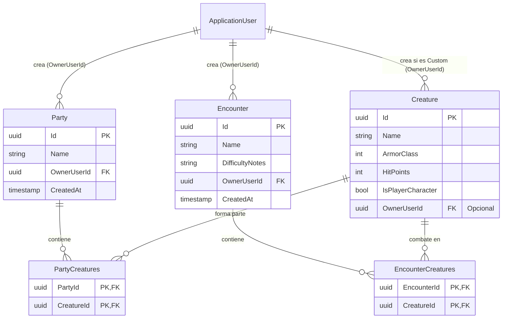

# ADR-0014: Diseño de Relaciones Many-to-Many para Partys y Encuentros, Gestión de Tablas Intermedias en EF Core y Prevención de Ciclos de Serialización JSON

- **Fecha:** 2026-10-22
- **Estado:** Aceptado
- **Decisores:** Equipo de Arquitectura de Sparnarok

## Contexto y Problema

Con la consolidación del motor de combate táctico grupal (Fase 2.4) y la persistencia de identidad de usuarios con Google OAuth2 y JWT (Fase 3), el Módulo 1 (Combat Engine) requería completar su experiencia de usuario introduciendo persistencia de composiciones de combate bajo la **Fase 3.5: Gestor de Partys y Encuentros**:

1. **Gestión de Partys:** Permitir a los Dungeon Masters y jugadores guardar y cargar grupos de héroes personalizados (Team A). Un héroe custom puede pertenecer a múltiples partys simultáneamente.
2. **Gestión de Encuentros:** Permitir a los DMs configurar y almacenar encuentros con monstruos del bestiario (Team B) junto con notas de dificultad (`DifficultyNotes`).
3. **Invariantes de Dominio Estrictas:**
   - Una `Party` solo puede contener combatientes marcados como personajes de jugador (`IsPlayerCharacter == true`).
   - Un `Encounter` asocia criaturas destinadas a oponentes del bestiario.
4. **Seguridad y Aislamiento por Usuario:** Las partys y encuentros deben pertenecer estrictamente a su creador (`OwnerUserId`). Ningún usuario ajeno debe poder consultar, modificar, agregar o eliminar criaturas de un encuentro o party que no le pertenezca (autorización a nivel de recurso -> 403 Forbidden).
5. **Serialización JSON y Evitación de Ciclos:** Las relaciones Many-to-Many bidireccionales en ORMs son propensas a provocar excepciones por bucles infinitos de serialización (`JsonException: A possible object cycle was detected`) o requerir metadatos intrusivos (`$id`/`$ref`).

---

## Opciones Evaluadas

### Opción 1: Almacenamiento Desnormalizado en Columnas JSONB (`List<Guid> CreatureIds`)
Almacenar los identificadores o snapshots de criaturas en una columna JSON/JSONB de PostgreSQL dentro de las tablas `Parties` y `Encounters`.
- *Ventajas:* No requiere tablas intermedias; lectura directa en una sola consulta.
- *Desventajas:* Pérdida de integridad referencial relacional (Foreign Keys). Si una criatura o héroe custom es actualizado o eliminado, el JSONB queda desfasado con IDs huérfanos. Dificultad para realizar consultas agregadas relacionales y migraciones estrictas de esquema.

### Opción 2: Entidad Intermedia Explícita con Navegación Bidireccional (`PartyCreature` con `Creature.Parties`)
Crear entidades de dominio intermedias explícitas (`PartyCreature`, `EncounterCreature`) y agregar colecciones bidireccionales en `Creature` (`public ICollection<PartyCreature> PartyCreatures { get; }`).
- *Ventajas:* Permite adjuntar metadatos adicionales a la relación en el futuro (ej. posición táctica inicial en la grilla).
- *Desventajas:* Contamina fuertemente la entidad raíz de agregación `Creature`, acoplándola a conceptos de composición de combate. Al serializar entidades directamente, causa ciclos infinitos de serialización JSON (`Party -> Creature -> PartyCreature -> Party`). Aumenta la complejidad del grafo de objetos en memoria.

### Opción 3: Relaciones Many-to-Many con Tablas Intermedias Gestionadas por EF Core, Navegación Unidireccional y DTO Projections [SELECCIONADA]
Modelar `Party` y `Encounter` con colecciones de navegación hacia `Creature` (`List<Creature>`), mientras que `Creature` permanece agnóstica e independiente (sin colecciones de navegación inversa hacia `Party` o `Encounter`). EF Core gestiona las tablas intermedias relacionales `PartyCreatures` y `EncounterCreatures` mediante `UsingEntity`.
- *Ventajas:* Integridad referencial total a nivel de motor de base de datos relacional (Foreign Keys, índices y Cascade Delete); modelo de dominio limpio y desacoplado; imposibilidad arquitectónica de ciclos infinitos en JSON; proyecciones explícitas a DTOs para la API REST.

---

## Razones de la Decisión

Se seleccionó la **Opción 3** por los siguientes motivos arquitectónicos y de ingeniería de software:

### 1. Invariante de Dominio en el Agregado
La entidad `Party` actúa como raíz de agregado para su composición de héroes, garantizando que ninguna criatura no jugable sea añadida:
```csharp
public void AddMember(Creature creature)
{
    ArgumentNullException.ThrowIfNull(creature);
    if (!creature.IsPlayerCharacter)
    {
        throw new InvalidOperationException("Solo se pueden agregar criaturas de tipo Personaje de Jugador (IsPlayerCharacter = true) a una Party.");
    }

    if (!Members.Any(m => m.Id == creature.Id))
    {
        Members.Add(creature);
    }
}
```

### 2. Configuración Relacional de Tablas Intermedias en EF Core
En `PartyConfiguration` y `EncounterConfiguration`, se configuran las tablas intermedias utilizando la API fluida de EF Core:
```csharp
builder.HasMany(p => p.Members)
    .WithMany()
    .UsingEntity(
        "PartyCreatures",
        l => l.HasOne(typeof(Creature)).WithMany().HasForeignKey("CreatureId").OnDelete(DeleteBehavior.Cascade),
        r => r.HasOne(typeof(Party)).WithMany().HasForeignKey("PartyId").OnDelete(DeleteBehavior.Cascade),
        j =>
        {
            j.HasKey("PartyId", "CreatureId");
            j.ToTable("PartyCreatures");
        });
```
- La clave primaria compuesta `(PartyId, CreatureId)` previene duplicados en la base de datos.
- `OnDelete(DeleteBehavior.Cascade)` garantiza que si se elimina una `Party` o un `Encounter`, los registros de unión en la tabla intermedia se limpien automáticamente sin dejar huérfanos, preservando intactas las criaturas subyacentes.

### 3. Prevención Absoluta de Ciclos de Serialización JSON
La estrategia de diseño aborda la serialización en dos niveles defensivos:
1. **Nivel de Dominio:** `Creature` no contiene propiedades `Parties` ni `Encounters`. La navegación es estrictamente unidireccional (`Party -> Creature` y `Encounter -> Creature`), lo que elimina cualquier grafo cíclico en el modelo.
2. **Nivel de Aplicación / DTO:** Los controladores `PartiesController` y `EncountersController` nunca retornan entidades del dominio directamente. Siempre proyectan a DTOs planos (`PartyResponseDto`, `EncounterResponseDto`, `CreatureResponseDto`):
   ```csharp
   public record PartyResponseDto(
       Guid Id,
       string Name,
       Guid OwnerUserId,
       DateTime CreatedAt,
       IReadOnlyList<CreatureResponseDto> Members
   );
   ```
   Esto garantiza un payload JSON limpio, determinista y sin referencias circulares ni metadatos `$id` / `$values`.

### 4. Autorización a Nivel de Recursos (Resource-Level Authorization)
Tanto `PartiesController` como `EncountersController` extraen el `UserId` desde el claim `ClaimTypes.NameIdentifier` del JWT. 
- En operaciones de lectura, los repositorios filtran estrictamente por `OwnerUserId == currentUserId`.
- En operaciones de mutación puntual (ej. `POST /api/v1/encounters/{id}/creatures/{creatureId}` o `DELETE /api/v1/encounters/{id}`), si el recurso existe pero pertenece a otro usuario, el controlador responde inmediatamente con `403 Forbidden`:
   ```csharp
   if (encounter.OwnerUserId != currentUserId)
   {
       return Forbid();
   }
   ```

---

## Diagrama Entidad-Relación



---

## Consecuencias y Validación

### Consecuencias Positivas
- **Persistencia Robusta:** Partys y Encuentros se almacenan en tablas normalizadas con claves primarias, índices y restricciones de integridad en PostgreSQL.
- **Rendimiento Óptimo:** Consultas con `Include(p => p.Members)` o `Include(e => e.Creatures)` se resuelven en un único `JOIN` eficiente.
- **Seguridad Garantizada:** Segregación total de datos entre usuarios y verificación estricta de propiedad contra ataques de escalamiento horizontal de privilegios (BOLA/IDOR).
- **Frontend Intuitivo:** La SPA en React actualiza dinámicamente Team A y Team B desde dropdowns dedicados, ofreciendo modal de guardado y feedback sin recargas de página.

### Validación
- **Tests Unitarios:** Verificación de invariantes en `Party.AddMember` y verificación de `Forbid()` (403 Forbidden) cuando un usuario intenta asociar criaturas a un `Encounter` de otro propietario.
- **Tests de Integración:** Validación completa de persistencia en PostgreSQL / SQLite en memoria, comprobando aislamiento entre usuarios y respuestas 403 / 404.
- **Tests End-to-End (Playwright):** Simulación completa de un usuario autenticado creando 3 Héroes Custom, guardándolos como una nueva Party, limpiando la pantalla, y recargando la Party desde el selector para verificar el re-poblado exacto de combatientes en el DOM.
