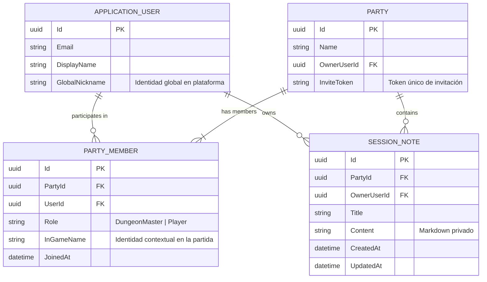

# ADR-0018: Modelo de Identidad Dual (Global User vs Party Member) y Aislamiento de Datos por Row-Level Security para Notas Privadas de Sesión

- **Fecha:** 2026-10-23
- **Estado:** Aceptado
- **Decisores:** Equipo de Arquitectura de Sparnarok

---

## Contexto y Problema

A medida que Sparnarok evoluciona hacia una plataforma multijugador y colaborativa para partidas de D&D 5e (reglas 2024), surgen dos necesidades fundamentales de privacidad e identidad:

1. **Identidad Dual (Global vs Contextual en Partida):**
   - Un usuario registrado (`ApplicationUser`) posee una identidad global en la plataforma (`DisplayName`, `Email`, y ahora `GlobalNickname`). Este identificador representa su presencia en el sistema y sirve como valor por defecto al interactuar.
   - Sin embargo, dentro de una campaña o grupo específico (`Party`), la identidad de un aventurero o director de juego es **contextual**:
     - Un jugador interpreta a un personaje específico (por ejemplo, "Elendur", el pícaro elfo).
     - El director de juego puede preferir un alias inmersivo para esa partida (por ejemplo, "El Señor Oscuro" o "El Cronista").
     - Además, un usuario puede asumir el rol de `DungeonMaster` en una party y de `Player` en otra.
   - Por tanto, se requiere desacoplar la identidad global del usuario de su afiliación contextual en la party mediante una entidad intermedia explícita (`PartyMember`) que capture `Role` e `InGameName`.
   - Adicionalmente, el flujo de incorporación a una party debe soportar enlaces de invitación seguros por token (`/api/parties/join/{token}`), donde el usuario invitado define su `Role` e `InGameName` antes de ingresar formalmente al grupo.

2. **Privacidad y Aislamiento de Notas de Sesión (Private Session Notes):**
   - En la Fase 3.6 (ADR-0017), las notas de sesión estaban restringidas exclusivamente al creador de la party (`OwnerUserId`) asumiendo el rol de Dungeon Master.
   - En una mesa de rol real, **todos los participantes** necesitan tomar notas privadas durante las sesiones:
     - El DM anota estadísticas secretas, pistas ocultas, planes de PNJs y trampas sin revelar al grupo.
     - Cada jugador lleva su propio diario de campaña, secretos de trasfondo, inventarios personales o teorías conspirativas sobre la trama.
   - Bajo ninguna circunstancia un miembro del grupo debe tener acceso de lectura, modificación o eliminación sobre las notas de otro miembro, incluso si ambos pertenecen a la misma Party.
   - En consecuencia, la pestaña de notas debe estar habilitada para todos los roles ("Mis Notas"), pero el backend debe garantizar un aislamiento estricto de datos (*Logical Row-Level Security*).

---

## Opciones Evaluadas

### Opción 1: Notas de Sesión Compartidas a Nivel de Party
Todas las notas pertenecen a la `PartyId` y cualquier miembro con acceso a la party puede leerlas y editarlas.
- *Desventajas Críticas:* **Incompatible con D&D.** Revela los secretos del DM a los jugadores (metagaming) y expone los diarios personales de cada personaje al resto del grupo.

### Opción 2: Notas Segregadas Únicamente por Rol (Notas de DM vs Notas de Jugadores)
El DM tiene un cuaderno y los jugadores comparten un cuaderno colectivo de grupo.
- *Desventajas:* Impide la privacidad entre jugadores. Si el pícaro descubre una gema oculta y la registra en sus notas, el paladín no debería enterarse automáticamente.

### Opción 3: Modelo de Identidad Dual + Aislamiento Estricto por Row-Level Security Lógico [SELECCIONADA]
- **Identidad Global:** Se añade `GlobalNickname` a `ApplicationUser`, configurable mediante `PUT /api/users/profile` y accesible desde la vista "Mi Perfil".
- **Identidad Contextual en Party:** Se introduce la entidad `PartyMember` con clave única `(PartyId, UserId)`, almacenando `Role` ("DungeonMaster" | "Player") e `InGameName` (alias local). Tanto la creación de la party como el ingreso por token (`POST /api/parties/join/{token}`) requieren definir estos valores.
- **Notas Privadas:** Se asocia cada `SessionNote` a un `OwnerUserId`. El controlador `SessionNotesController` y el repositorio aplican Row-Level Security en todas las operaciones (`GET`, `POST`, `PUT`, `DELETE`), garantizando que la cláusula `WHERE PartyId == @PartyId AND OwnerUserId == @CurrentUserId` sea inviolable.

---

## Razones de la Decisión

Se seleccionó la **Opción 3** por los siguientes principios de arquitectura y diseño:

### 1. Modelo de Identidad Dual (Domain Entity Separation)



- **Separación de Responsabilidades:** `ApplicationUser.GlobalNickname` responde a "¿Quién eres en Sparnarok?", mientras que `PartyMember.InGameName` responde a "¿Quién eres en esta campaña particular?".
- **Onboarding Guiado:** Al crear una Party, el creador especifica su rol y apodo inicial. Al unirse vía token (`POST /api/parties/join/{token}`), el usuario invitado recibe una vista previa pública de la campaña (`PartyInviteDetailsDto`) y suministra su `Role` e `InGameName` mediante el modal de onboarding en React.

### 2. Estrategia de Aislamiento de Datos (Logical Row-Level Security)

En `SessionNotesController`, ningún usuario puede consultar, modificar o borrar notas que no le pertenezcan:

```csharp
[HttpGet]
public async Task<ActionResult<List<SessionNoteResponseDto>>> GetAll(
    Guid partyId,
    CancellationToken ct)
{
    var party = await _partyRepository.GetByIdAsync(partyId, ct);
    if (party == null) return NotFound("Party no encontrada.");

    var userId = GetCurrentUserId();
    // Validar membresía en la party
    var isMember = party.OwnerUserId == userId || 
                   party.PartyMembers.Any(m => m.UserId == userId);
    if (!isMember) return Forbid();

    // RLS Lógico: SOLO se retornan las notas del usuario autenticado
    var notes = await _sessionNoteRepository.GetAllByPartyAndOwnerAsync(partyId, userId, ct);
    return Ok(notes.Select(MapToDto).ToList());
}
```

En las mutaciones (`PUT`, `DELETE`, `GET {id}`):
```csharp
if (note.OwnerUserId != currentUserId)
{
    // Retorna 403 Forbidden impidiendo que el Usuario A altere o lea las notas del Usuario B
    return Forbid();
}
```

### 3. Índice Compuesto en Base de Datos

Para asegurar que las consultas filtradas por `(PartyId, OwnerUserId)` sean de alto rendimiento bajo PostgreSQL:

```csharp
builder.HasIndex(n => new { n.PartyId, n.OwnerUserId })
       .HasDatabaseName("IX_SessionNotes_PartyId_OwnerUserId");
```

---

## Consecuencias y Verificación

### Aspectos Positivos
- **Privacidad Absoluta:** Nadie en el grupo puede interceptar o leer las notas de sus compañeros ni del DM.
- **Inmersión de Rol:** Los jugadores pueden tener nombres temáticos de personaje en cada campaña sin alterar su perfil global de Google o de cuenta.
- **Experiencia de Onboarding Fluida:** Si un aventurero recibe un enlace con `?inviteToken=...`, la interfaz web detecta el parámetro, presenta el modal de bienvenida y configura su rol antes de redirigirlo a la sesión en vivo.

### Verificación Automatizada (Definition of Done)
1. **Tests Unitarios de Backend (`SessionNotesTests`):** Simulan dos `ClaimsPrincipal` (`UserA` y `UserB`). Verifican que `UserA` solo obtiene sus propias notas y que una solicitud de `UserA` para leer, modificar o borrar notas de `UserB` resulta invariablemente en `403 Forbidden`.
2. **Tests de Integración de Backend (`SessionNotesIntegrationTests`):** Crean una party con `UserA` como DM ("El Señor Oscuro"), unen a `UserB` vía token como Player ("Elendur"), registran notas para ambos usuarios y confirman que el endpoint REST aísla las colecciones al 100%.
3. **Tests Unitarios de Frontend (Vitest):** Prueban `PartyOnboardingModal` y `UserProfileModal` garantizando que los inputs y los llamados a la API transmiten correctamente `Role`, `InGameName` y `GlobalNickname`.
4. **Test E2E (Playwright):** Simula el flujo completo de dos usuarios en contextos aislados y verifica la ausencia de notas cruzadas en el DOM.
