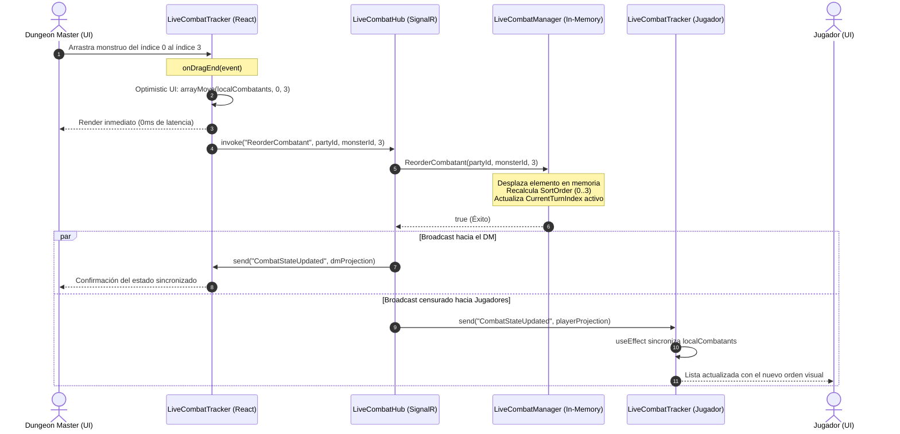

# ADR-0019: Ordenamiento Posicional Táctico en Vivo mediante Drag & Drop (@dnd-kit) e Iniciativa Opcional en LiveCombatHub

- **Fecha:** 2026-10-23
- **Estado:** Aceptado
- **Decisores:** Equipo de Arquitectura y UX de Sparnarok

---

## Contexto y Problema

En la implementación inicial del gestor de combate táctico en vivo (ADR-0017), el orden de actuación de los combatientes dependía exclusivamente de un cálculo matemático estricto:

$$\text{ORDER BY Initiative DESC, IsPlayerCharacter DESC, Name ASC}$$

Si bien este enfoque matemático es coherente con simulaciones estáticas de Montecarlo, en una sesión de mesa en vivo de **Dungeons & Dragons 5e (reglas 2024)** se convirtió en una limitación crítica de Experiencia de Usuario (UX) para el Dungeon Master (DM):

1. **Rigidez Táctica en Mesa Real:**
   - En D&D es habitual que el DM agrupe monstruos similares para que actúen juntos (*side initiative* o turnos en bloque).
   - Existen situaciones de emboscada, turnos retenidos (*held action*), empates arbitrados por el DM o intervenciones narrativas inmediatas que requieren mover a un combatiente hacia arriba o abajo en la lista.
   - Forzar a que cada combatiente tenga obligatoriamente una tirada de iniciativa numérica interrumpe la agilidad del combate e impide ingresar combatientes secundarios o esbirros sin dados.

2. **Acoplamiento Innecesario a la Métrica de Iniciativa:**
   - La iniciativa numérica debe ser una referencia orientativa y opcional, no el motor inmutable de ordenamiento.
   - Si un combatiente no tiene iniciativa cargada (`null`), el sistema no debe fallar ni forzar números artificiales (como `10` por defecto).

3. **Necesidad de Control Visual Directo para el DM:**
   - El Dungeon Master requiere una interfaz visual intuitiva mediante **Drag & Drop** táctil y con cursor para reordenar turnos sobre la marcha.
   - Dicho reordenamiento debe propagarse en tiempo real a todos los clientes (Jugadores y DM) vía WebSockets / SignalR.
   - Los Jugadores jamás deben tener la capacidad de alterar el orden de turnos establecido por el DM.

---

## Opciones Evaluadas

### Opción 1: Reordenamiento Numérico Forzado (Floating Point Hacks)
Mantener `ORDER BY Initiative DESC` y, cuando el DM arrastra un combatiente entre la posición $i$ e $i+1$, asignar un valor flotante intermedio $\text{Initiative} = \frac{\text{Init}_i + \text{Init}_{i+1}}{2}$.
- *Desventajas Críticas:* Altamente frágil. Sufre de pérdida de precisión por redondeo en punto flotante (`0.0000001`), no funciona cuando dos combatientes tienen el mismo valor numérico y confunde tanto a jugadores como al DM al ver números de iniciativa con decimales extraños en su pantalla.

### Opción 2: Librería `react-beautiful-dnd` en el Frontend
Utilizar `react-beautiful-dnd`, una biblioteca histórica popular para listas reordenables en React.
- *Desventajas Críticas:* Proyecto deprecado y abandonado por Atlassian. Presenta incompatibilidad nativa con React 18/19 Concurrent Mode y StrictMode, depende de mutaciones forzadas sobre el DOM real e incrementa el tamaño del bundle innecesariamente.

### Opción 3: Ordenamiento Posicional Persistido en Hub (`SortOrder`) + `@dnd-kit` en React [SELECCIONADA]
- **Backend (SignalR & In-Memory State):**
  - El modelo `LiveCombatState` adopta una propiedad explícita `SortOrder` (índice 0-indexed) como la **única fuente de verdad** del orden de los turnos.
  - Al recibir `ReorderCombatant(partyId, combatantId, newIndex)`, el backend desplaza el elemento en la lista en memoria, recalcula los `SortOrder = 0..N-1`, actualiza dinámicamente el `CurrentTurnIndex` para mantener el foco en el combatiente en turno, y hace broadcast inmediato del nuevo estado censurado/no censurado a todos los grupos de la Party.
  - Al iniciar el combate (`StartCombat`), se respeta exactamente el orden posicional fijado por el DM sin reordenar por iniciativa.
  - La propiedad `Initiative` pasa a ser opcional (`decimal?` / `number | null`). Si se agregan nuevos combatientes sin iniciativa, se adjuntan al final de la lista.
- **Frontend (React 19):**
  - Implementación con `@dnd-kit/core` y `@dnd-kit/sortable`.
  - Envolvimiento de la lista en `SortableContext` con estrategia `verticalListSortingStrategy`.
  - Incorporación de un **Drag Handle** (`≡`) exclusivo para el DM (`role === 'DungeonMaster'`).
  - Actualización optimista instantánea en React (`arrayMove`) para latencia percibida de 0ms, seguida de la invocación de `ReorderCombatant` vía SignalR.

---

## Justificación Técnica de `@dnd-kit`

La elección de `@dnd-kit` como estándar para Sparnarok responde a los siguientes pilares de arquitectura:

1. **Arquitectura Moderna y Modular para React 19:**
   - Diseñado desde cero para la API de Hooks de React (`useSortable`, `useSensors`, `useSensor`).
   - No realiza mutaciones externas al DOM. Emplea transformaciones CSS puras (`CSS.Transform.toString(transform)`) optimizadas para la GPU del navegador.
   - Peso de bundle extremadamente reducido comparado con bibliotecas monolíticas legadas.

2. **Accesibilidad Integral (a11y) y Control de Puntero:**
   - Soporte nativo para navegación por teclado mediante `KeyboardSensor` y coordenadas `sortableKeyboardCoordinates`.
   - `PointerSensor` configurado con restricción de activación (`activationConstraint: { distance: 3 }`), asegurando que los clics ordinarios en botones de vida, visibilidad o edición de iniciativa no disparen accidentalmente eventos de arrastre.
   - Atributos ARIA generados dinámicamente para lectores de pantalla.

3. **Separación de Responsabilidades y Seguridad por Rol:**
   - La propiedad `disabled: !isDm` en `useSortable` garantiza que los oyentes de eventos (`listeners`) ni siquiera existan en el DOM de los jugadores.
   - El backend valida el rol del remitente, garantizando que un jugador no pueda alterar el orden de combate emitiendo comandos SignalR maliciosos.

---

## Diagrama de Secuencia: Reordenamiento Optimista y Sincronización en Tiempo Real

---

## Consecuencias y Beneficios

### Positivas:
1. **Flexibilidad Absoluta para el DM:** El DM tiene control total sobre el orden de actuación arrastrando combatientes sin restricciones numéricas.
2. **Iniciativa Opcional:** Combatientes sin iniciativa pueden participar normalmente con visualización limpia (`-`) sin que la interfaz o el motor de combate lancen errores.
3. **Persistencia y Reactividad Instantánea:** El orden se preserva en la sesión activa del servidor y se propaga en subsegundos a todos los participantes.
4. **Preservación de Turno en Curso:** Si el DM reordena la lista mientras un combatiente está actuando, el índice del turno activo se ajusta automáticamente para que el turno no salte indebidamente a otro combatiente.

### Mitigaciones y Consideraciones:
- Si la conexión WebSocket de SignalR se interrumpe temporalmente, el estado local del DM opera con actualización optimista y el fallback en `localStorage` / `BroadcastChannel` mantiene la coherencia entre pestañas locales hasta restablecer la conexión.
